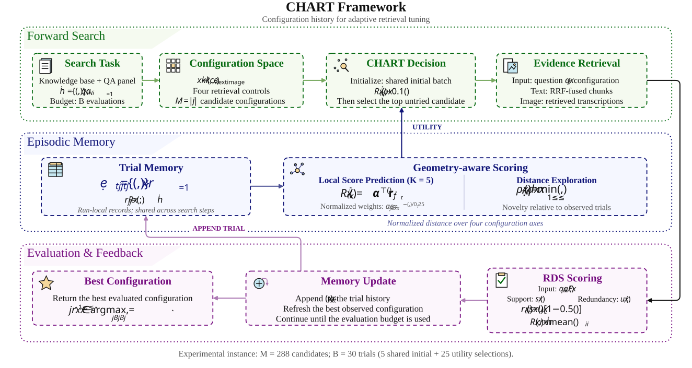
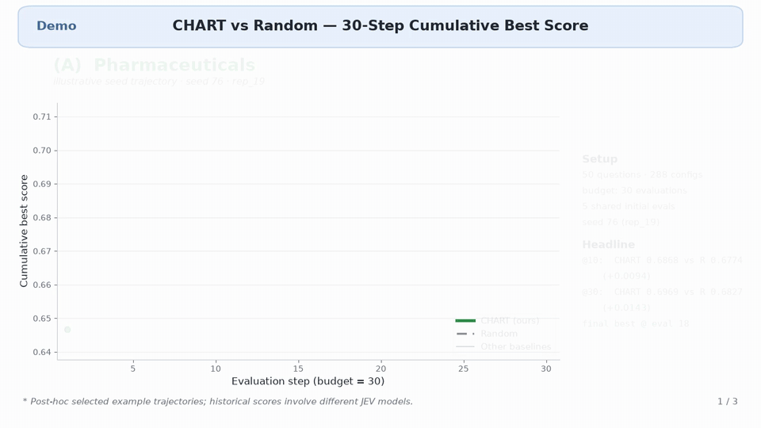
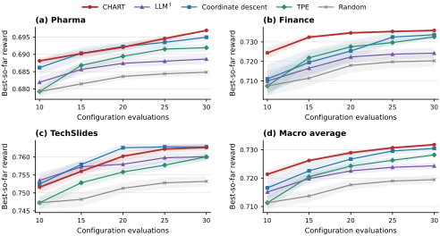

<h1 align="center">CHART: Configuration History for Adaptive Retrieval Tuning</h1>

<p align="center">
  <a href="https://github.com/chery-nextai">Chenchen Zhao</a><sup>*</sup>,
  <a href="https://github.com/chery-nextai">Yi Wei</a><sup>*</sup>,
  <a href="https://github.com/chery-nextai">Zhengyu Chen</a>,
  <a href="https://github.com/chery-nextai">Ma Xiao</a>,
  <a href="https://github.com/chery-nextai">Yijun Chen</a>,
  <a href="https://github.com/chery-nextai">Zhiquan Hu</a>,
  <a href="https://github.com/chery-nextai">Chao Han</a>,
  <a href="https://github.com/chery-nextai">Xiao Zhang</a><sup>†</sup>,
  <a href="https://github.com/chery-nextai">Chuang Dai</a>
</p>

<p align="center">NEXTAI Research Institute, Chery Group.</p>

<p align="center"><sub>* Equal contribution. † Corresponding author.</sub></p>

<p align="center">
  Budgeted configuration search for multimodal retrieval-augmented generation
</p>

<p align="center">
  <a href="#-overview">Overview</a> ·
  <a href="#-method">Method</a> ·
  <a href="#-demo">Demo</a> ·
  <a href="#-results">Results</a> ·
  <a href="#-getting-started">Getting started</a> ·
  <a href="#-reproducibility">Reproducibility</a>
</p>

<p align="center">
  
  
  
  <a href="LICENSE"></a>
</p>

## 💡 Overview

The best retrieval setup depends on the document collection. **CHART** searches text and image retrieval depth, chunk size, and embedding backend within a fixed budget, using observed rewards to choose each next configuration. It returns the highest-scoring configuration it evaluated.

**Redundancy-Discounted Support (RDS)** scores reference-answer support while discounting repeated facts. CHART selects the next configuration using trial memory and a distance-based exploration bonus; it uses no LLM for search decisions.

## 🧭 Method

<p align="center">
  
</p>

Each configuration is a tuple of four choices:

| Component | Values |
| --- | --- |
| Text top-*k* | `5`, `10`, `20`, `40` |
| Image top-*k* | `0`, `1`, `3`, `5`, `10`, `20` |
| Chunk size | `64`, `128`, `256`, `512` |
| Embedding backend | `jina_nano`, `jina_small`, `qwen3_vl_2b` |

The search space has **288 configurations**. Each run starts with five shared evaluations, then makes 25 selections. CHART estimates each untried configuration's reward from its five nearest trials, adds a distance-based exploration bonus, and evaluates the highest-utility option.

For a question *q*, RDS combines the judge's support probability and expected semantic redundancy:

```text
reward(q) = P(support | q, evidence) × [1 − 0.5 × E(redundancy | q, evidence)]
configuration reward = mean reward(q) over the fixed question set
```

Images are transcribed into question-independent facts. RDS is an **evidence-level proxy**, not a recall metric or a direct measure of answer accuracy.

## 🎬 Demo

<p align="center">
  
</p>

<p align="center"><em>Illustrative trajectories selected post hoc; scores use historical JEV models. The complete 20-seed comparison below is the primary quantitative result.</em></p>

## 📈 Results

We compare CHART with Random, coordinate descent, TPE, and an LLM controller on three document collections. Each uses 50 fixed questions and 20 paired seeds; methods share five starting configurations and a 30-evaluation budget. **Reward@k** is the best RDS reward in the first *k* evaluations, averaged across seeds.

| Dataset | CHART @10 | Random @10 | CHART @30 | Random @30 | Coordinate descent @30 | TPE @30 | LLM @30 |
| --- | ---: | ---: | ---: | ---: | ---: | ---: | ---: |
| Pharmaceuticals | **0.6881** | 0.6792 | **0.6969** | 0.6848 | 0.6950 | 0.6919 | 0.6886 |
| Finance EN | **0.7244** | 0.7074 | **0.7359** | 0.7203 | 0.7337 | 0.7326 | 0.7243 |
| Techslides | **0.7516** | 0.7473 | 0.7627 | 0.7532 | **0.7628** | 0.7601 | 0.7601 |

These are the complete **20-seed** results. CHART's mean Reward@30 is higher than Random's on all three datasets; coordinate descent is slightly higher on Techslides. Values are point estimates.

<p align="center">
  
</p>

<p align="center"><em>Mean best-so-far RDS reward over 20 paired seeds; shading shows ±1 standard error. The macro panel averages the three datasets within each seed before computing uncertainty.</em></p>

## 🔧 Getting started

### 1. Install

```bash
git clone https://github.com/chery-nextai/CHART.git chart
cd chart
python3 -m venv .venv
source .venv/bin/activate
python -m pip install -r requirements.txt
cp .env.example .env
```

Set `.env` with model endpoints, credentials, corpus paths, Elasticsearch, and local embedding paths. The example file lists the variables. Running a search also requires these services and prepared indexes.

### 2. Prepare data and indexes

The repository includes **50-question subsets**, but not source documents, images, model weights, or indexes. Obtain each corpus under its license and prepare 15 indexes per dataset: 12 text and 3 image indexes.

```bash
bash scripts/run.sh --validate-only
```

For index-building options, run `python scripts/build_ao_dataset_index.py --help`.

### 3. Run CHART

```bash
DATASET=techslides POLICIES=jit_no_rules SEEDS=20 STEPS=25 bash scripts/run.sh
```

`jit_no_rules` runs CHART; `jit` is the rule-augmented ablation.

`DATASET` selects the collection; an empty `POLICIES` runs all six strategies. `SEEDS` sets repeats and `STEPS` sets decisions after initialization. Use `TEXT_TOPK`, `IMAGE_TOPK`, `CHUNKS`, and `BACKENDS` to narrow the search space; see [the frozen configuration](configs/definitive_runs.json).

## 📂 Data and indexes

| Dataset | Document pages | Included evaluation subset |
| --- | ---: | --- |
| `pharmaceuticals` | 2,313 | [`qa_screened50_from_200.json`](datasets/ao_ready_v1_subsets/pharmaceuticals/qa_screened50_from_200.json) |
| `finance_en` | 2,942 | [`qa_screened50_from_179.json`](datasets/ao_ready_v1_subsets/finance_en/qa_screened50_from_179.json) |
| `techslides` | 1,963 | [`qa_screened50_from_200.json`](datasets/ao_ready_v1_subsets/techslides/qa_screened50_from_200.json) |

Each subset has 50 questions with reference answers. Provide `corpus.json` and its image files, then set `CHART_AO_CORPUS_ROOT` or a dataset-specific `CHART_AO_CORPUS_DIR_*` in `.env`. Set `CHART_INDEX_PREFIX_*` if index names differ. Follow the corpus publishers' licenses.

## 🔁 Reproducibility

`configs/definitive_runs.json` records the frozen 20-seed protocol. Run outputs and caches are generated locally and are not included in the repository. Use `scripts/run_search.sh` for the frozen search setup.

## 🗺️ Code map

```text
chart/
├── pipeline/             Search entry points, strategies, and RDS reward
├── controllers/          LLM and baseline controllers
├── environment/          Dataset and evaluation runner
├── memory/               Trial memory
├── rag_pipeline/         Retrieval and model clients
└── judge_client.py       Judge API adapters
scripts/
├── run.sh                Configurable search
├── run_search.sh         Frozen-protocol search
└── build_ao_dataset_index.py
configs/definitive_runs.json
datasets/ao_ready_v1_subsets/
assets/                   Framework, results, and demo media
```

## 📜 License

Code is released under the [MIT License](LICENSE). Dataset and model terms are set by their publishers.
